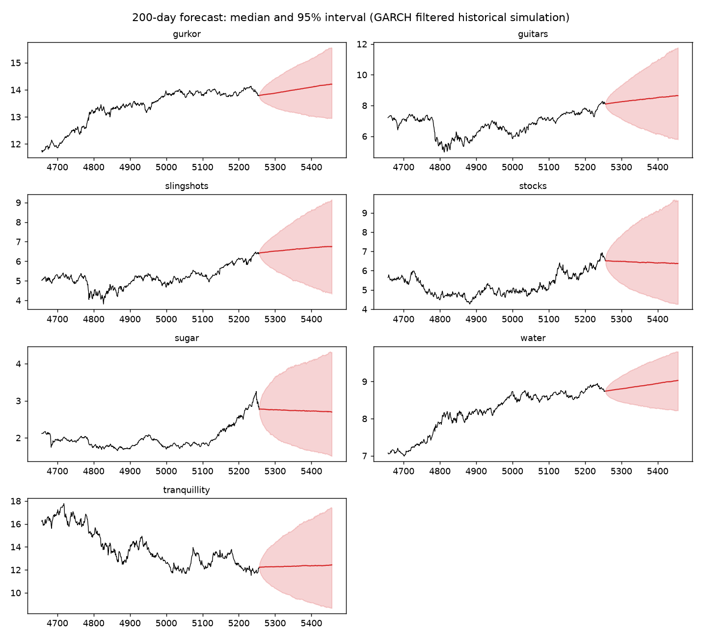
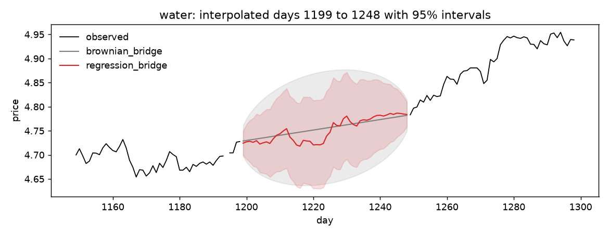
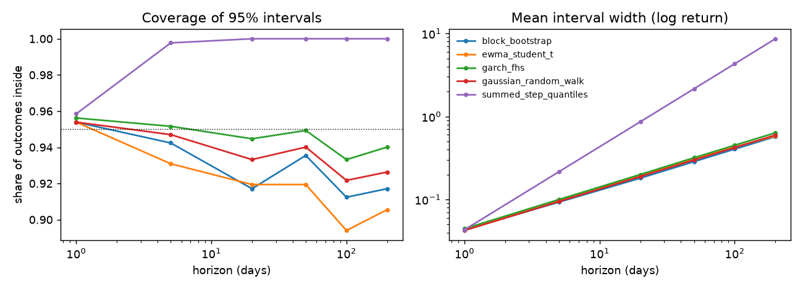
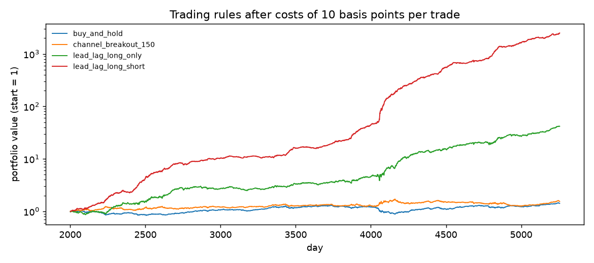

# Financial time series: interpolation, forecasting and trading on seven price series

Project in the course Financial Time Series (TMS088 at Chalmers University of
Technology, MSA410 at the University of Gothenburg), spring 2026.

The data is seven daily price series over 5456 days, made for the course
(`gurkor`, `guitars`, `slingshots`, `stocks`, `sugar`, `water`,
`tranquillity`). Each series has a gap of 50 missing days, the last 200 days
are missing in all of them, and five days hold a placeholder value. The tasks
were to describe the series, fill the gaps, forecast the last 200 days with
uncertainty, and propose a trading rule.

This repository is a cleaned and extended version of my part of a group
project. The notebooks as they were handed in are kept in `original/`. What
changed, and what was wrong in the originals, is listed under
[Changes from the original notebooks](#changes-from-the-original-notebooks).

## Key findings

All numbers come from the tables in `results/`, which the scripts regenerate.

- **Only one series has a predictable mean, and only one day ahead.** Sugar's
  return follows the previous day's returns of slingshots and guitars
  (correlations 0.39 and 0.36). A ridge model on lagged returns explains 27% of
  sugar's next-day return out of sample, and about 2% for guitars and water.
  From two days ahead, no model beats the historical mean for any series.
  A random forest is worse than ridge everywhere. (`predictability_r2.csv`,
  `lead_lag.csv`)
- **So the 200-day forecast is about uncertainty, not the mean.** Six of the
  seven series show strong volatility clustering. Intervals from a GARCH(1,1)
  model with resampled residuals cover 93% to 96% of outcomes at every horizon
  from 1 to 200 days and have the best interval score at each of them.
  (`interval_backtest.csv`)
- **The original interval construction was wrong.** It added up one-day
  quantiles over the horizon. At 200 days that interval is 14 times wider than
  the GARCH interval and covers 100% of outcomes where 95% was intended.
- **The other series make gap filling much more accurate.** While one series
  is missing, the other six are observed. Using their returns cuts the
  interpolation error by 22% on average against a straight line, and by about
  40% for gurkor, water and guitars, with intervals that cover 97% where 95%
  was intended. The state-space model of the original notebook is slightly
  worse than a straight line and its intervals cover only 89%.
  (`interpolation_validation.csv`)
- **A trading rule on the lead-lag effect earns a Sharpe ratio of 5.8 before
  costs,** against 0.4 for buy and hold and for a channel breakout rule. It
  trades its whole book every day, so it stops being profitable at trading
  costs between 25 and 50 basis points. 81% of its gross return comes from
  sugar. (`strategy_performance.csv`, `strategy_by_series.csv`)



## Results in more detail

### Description of the series

Log prices have a unit root and log returns do not (ADF test). Returns of
gurkor and water move together (correlation 0.57), as do guitars and
slingshots (0.53); stocks is unrelated to everything and is the only series
without volatility clustering. The BDS test rejects independence for six
series, but that is explained by volatility clustering and does not by itself
mean that returns can be predicted.

### Interpolation of the 50-day gaps

Three methods, compared by hiding 40 blocks of 50 known days per series and
interpolating them (`fts.interpolate.validate`). Errors are in log price.

| Method | RMSE | Coverage of 95% interval | Mean interval width |
| --- | --- | --- | --- |
| Straight line with random-walk bridge variance | 0.0301 | 95.0% | 0.128 |
| Local linear trend + AR(1), Kalman smoother (original) | 0.0313 | 89.2% | 0.109 |
| Regression bridge on the other series | 0.0234 | 96.9% | 0.112 |

The regression bridge regresses the missing series' daily return on the other
series' returns of the same day, the day before and the day after. Inside the
gap the fitted returns give the path its shape, and the part the regression
does not explain is spread so that the path meets the known price after the
gap. The variance is that of a random walk tied at both ends, with the
residual standard deviation of the regression. For stocks, which is unrelated
to the other series, the method gives the same result as the straight line.



### Forecast intervals

Rolling-origin backtest: every 50 days from day 2000, each method sees the
returns up to the origin and gives a 95% interval for the cumulative log
return 1 to 200 days ahead (62 origins and 7 series, 434 forecasts per
horizon). The interval score rewards narrow intervals and penalises misses;
lower is better.

| Method | Coverage, 1 day | Coverage, 200 days | Interval score, 200 days |
| --- | --- | --- | --- |
| GARCH(1,1), filtered historical simulation | 95.6% | 94.0% | 0.958 |
| Gaussian random walk | 95.4% | 92.6% | 0.991 |
| Block bootstrap of past returns | 95.4% | 91.7% | 0.997 |
| Student-t random walk with EWMA volatility | 95.4% | 90.6% | 1.026 |
| Summed one-day quantiles (original) | 95.9% | 100% | 8.640 |

The final forecast in `results/forecast.csv` uses the GARCH simulation. For
sugar, guitars and water the first forecast day is shifted by the lead-lag
model's expected return (0.6%, 0.1% and 0.04%).



### Trading rules

Days 2001 to 5256. Weights are set at the close of each day and earn the next
day's return. The lead-lag forecasts are walk-forward: the models are refitted
every 250 days on earlier days only.

| Rule | Sharpe, no costs | Sharpe, 10 bp | Sharpe, 25 bp | Daily turnover |
| --- | --- | --- | --- | --- |
| Buy and hold, equal amounts | 0.36 | 0.36 | 0.36 | 0 |
| Channel breakout, 150 days | 0.41 | 0.39 | 0.36 | 0.7% |
| Lead-lag, long only | 3.51 | 1.69 | -1.04 | 131% |
| Lead-lag, long and short | 5.81 | 3.79 | 0.77 | 130% |



## Limitations

- The data is synthetic and made for the course. The size of the lead-lag
  effect, and therefore the Sharpe ratios above, say nothing about real
  markets.
- The data has no calendar. Annualised figures assume 252 days per year.
- Backtest origins 50 days apart share most of their 200-day test windows, so
  the 434 forecasts per horizon are far from independent. The coverage numbers
  at long horizons rest on about 16 non-overlapping windows per series.
- The 150-day lookback of the channel breakout was chosen by a teammate on the
  same data, so its result is not out of sample.
- The trading backtest has a flat cost per traded amount and no market impact,
  borrowing cost or position limits.
- The regression bridge assumes constant residual variance. With volatility
  clustering its intervals are too wide in calm periods and too narrow in
  volatile ones, although the average coverage is right.
- The interpolation regression is fitted on all data outside the gap,
  including later days. That is appropriate for filling a gap, but those
  interpolated values should not be used as inputs to a backtest. The
  forecasting and trading code never uses them: missing returns are left out.

## Changes from the original notebooks

`original/` holds the two notebooks as handed in. Problems found in them and
what replaces them here:

| Original | Problem | Now |
| --- | --- | --- |
| Rows with any missing value were dropped before taking log returns | Each 50-day gap became one large "daily" return in all seven series: for stocks the largest return was 30%, where the largest real one is 6% | Returns are only computed between consecutive observed days (`fts.data.log_returns`) |
| Outlier days removed by hard-coded row numbers | Breaks if the data changes | Detected by value (`fts.data.remove_outliers`) |
| Forecast intervals from summed one-day quantiles, averaged over backtest folds | 14 times too wide at 200 days; not an interval for the final forecast | Simulated price paths, checked by backtest (`fts.forecast`) |
| Water forecast from its own lag 1 and gurkor lags 3 and 4 | None of those lags is significant (correlations between -0.02 and 0.00). The usable effect for water is gurkor at lag 1, and the strong effect is in sugar | Lead-lag table and out-of-sample R² per series and horizon |
| One random forest per step for 200 steps, water only | No comparison with a baseline; no predictability beyond one day | All series, against the historical mean, ridge and random forest |
| Plot titles said "recursive forecast" | The method was direct | Fixed |
| Interpolation used the smoothed trend only | The AR(1) part of the fitted model was left out | Full smoothed signal; kept as a baseline, and scored |
| No check of the interpolation | | Hidden-block validation of three methods |
| Notebooks with repeated plotting code | | A small package, scripts and unit tests |

## Credits

The original was a group project. Two of the methods compared here are
reimplementations of teammates' ideas from the group repository
[tofflan69/TMS088](https://github.com/tofflan69/TMS088): the Student-t random
walk with EWMA volatility (`ewma_t_paths`), and the buy-and-hold, channel
breakout and "buy what is forecast to rise" trading rules in `fts/strategy.py`.
A teammate's imputation by a conditional multivariate Student-t distribution
uses the same cross-series idea as the regression bridge. The code in this
repository is my own.

## Layout

```
fts/
  data.py          load the prices, remove outliers, split history from the forecast days
  diagnostics.py   ADF, Ljung-Box, BDS and lead-lag tables
  interpolate.py   three gap-filling methods and their hidden-block validation
  forecast.py      predictability by horizon, interval methods, interval backtest
  strategy.py      trading rules and a common backtest
scripts/
  run_diagnostics.py     tables describing the series
  run_interpolation.py   validate the methods, fill the real gaps
  run_forecast.py        predictability, interval backtest, final forecast
  run_strategy.py        backtest of the trading rules
tests/             unit tests, mostly on simulated data with known answers
data/              spiff_data.csv, the course data
results/           tables and figures written by the scripts
original/          the two course notebooks as handed in
```

## Setup

Requires [uv](https://docs.astral.sh/uv/). Versions are pinned in `uv.lock`.

```bash
uv sync --locked
```

## Tests

```bash
uv run pytest
```

The tests check, among other things, that returns never span a gap, that the
bridge matches the simulated distribution of a random walk with a known end
value, that a planted one-day lead is found and nothing else is, that interval
coverage is right on a true random walk, and that neither the interval
backtest nor the walk-forward forecasts can see future data.

## How to run

```bash
uv run python scripts/run_diagnostics.py      # a few seconds
uv run python scripts/run_interpolation.py    # about 1 minute
uv run python scripts/run_forecast.py         # about 8 minutes
uv run python scripts/run_strategy.py         # a few seconds
```

Each script prints its tables and writes them, with the figures, to
`results/`. All random draws are seeded, so reruns give the same numbers.
